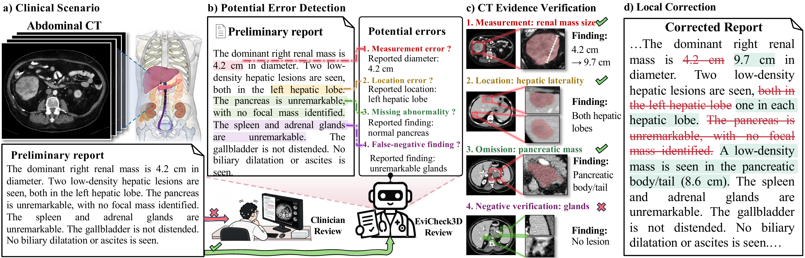
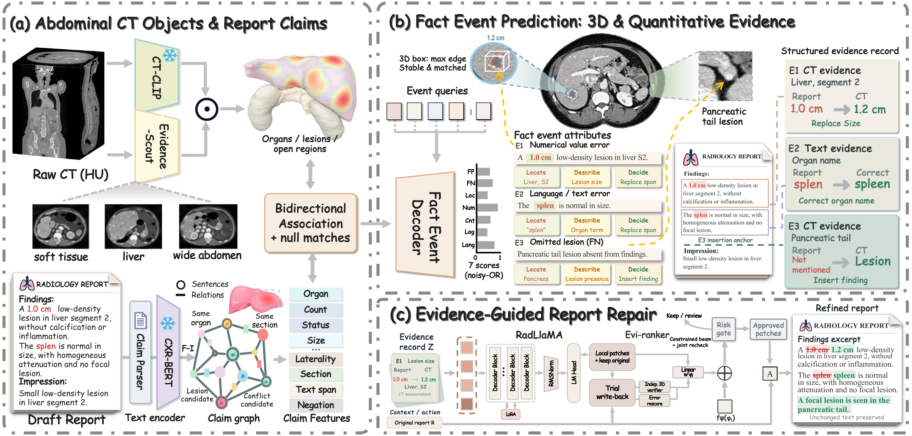

# EviCheck3D: Verifying and Correcting Draft Abdominal CT Reports with Traceable Evidence

#### EviCheck3D links errors in draft abdominal CT reports to supporting evidence and proposes local corrections while preserving unedited text.

<p align="center">
  
</p>

<p align="center">
  
</p>

## Datasets

Download the public datasets from their official sources:

| Dataset | Download instructions |
| --- | --- |
| AbdomenAtlas 3.0 | Download CT volumes, masks, and reports from [Hugging Face](https://huggingface.co/datasets/AbdomenAtlas/AbdomenAtlas3.0Mini), or use `download_atlas_3.sh` from [RadGPT](https://github.com/MrGiovanni/RadGPT#download-the-abdomenatlas-30-dataset). |
| AMOS-MM | Open the [official download page](https://era-ai-biomed.github.io/amos/dataset.html#download), select **AMOS-MM → Google Drive**, and download the CT images and report-generation annotations. |
| Merlin Abdominal CT | Follow the [official download guide](https://github.com/StanfordMIMI/Merlin/blob/main/documentation/download.md): complete the data-use agreement, then download using AzCopy and the URL supplied after approval. |

Keep all report variants from the same patient in one partition.

## Preprocessing

The manuscript uses the following CT preprocessing:

| Branch | Input shape (D × H × W) | HU windows |
| --- | --- | --- |
| Global CT-CLIP | `240 × 480 × 480`, resampled to `1.5 × 0.75 × 0.75 mm` spacing | `[-100, 400]` |
| Local EvidenceScout | `72 × 144 × 144`, three channels | `[-150, 250]`, `[-50, 150]`, `[-500, 500]` |

Construct each branch independently from the original HU volume. Retain original spacing, affine information, and unwindowed HU values for measurements. Reference reports provide training targets and are not inference inputs.

## Environment Setup

Use Linux with an NVIDIA GPU and a compatible CUDA/PyTorch installation:

```bash
conda create -n evicheck3d python=3.10 -y
conda activate evicheck3d
pip install -r requirements.txt
```

Install the additional dependencies of [CT-CLIP](https://github.com/ibrahimethemhamamci/CT-CLIP) and prepare its local code, checkpoint, and text-model assets. Set their paths and the language-model path in the configuration files.

## Training


```bash
cp configs/train.example.json configs/train.local.json
```


```bash
python scripts/train.py --config configs/train.local.json --check-config
CUDA_VISIBLE_DEVICES=0 python scripts/train.py --config configs/train.local.json
```

`--check-config` validates the schema only. A completed training chunk saves `checkpoint.pt` and `COMPLETE.json` in the configured output directory.

## Inference

```bash
cp configs/infer.example.json configs/infer.local.json
```


```json
{"report": "Synthetic report text.", "image_path": "/absolute/path/to/ct.nii.gz"}
```

```bash
python scripts/infer.py --config configs/infer.local.json --check-config
CUDA_VISIBLE_DEVICES=0 python scripts/infer.py --config configs/infer.local.json
```
